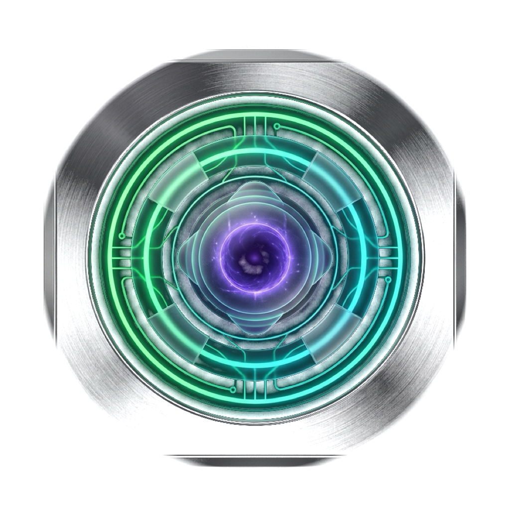
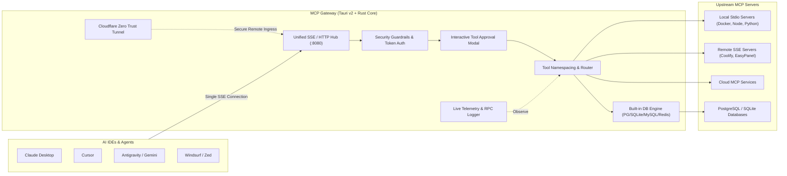

# MCP Gateway

<p align="center">
  
</p>

<p align="center">
  <strong>High-Performance Desktop Gateway & Multi-Transport Multiplexer for Model Context Protocol (MCP)</strong>
</p>

<p align="center">
  <a href="README.md">English</a> | <a href="README_TH.md">ภาษาไทย</a>
</p>

<p align="center">
  
  
  
  
  
  
  
</p>

---

## 📖 Overview

**MCP Gateway** is a native, cross-platform desktop control plane and multiplexer for Anthropic's [Model Context Protocol (MCP)](https://modelcontextprotocol.io/).

Normally, AI agents and IDEs (Cursor, Claude Desktop, Antigravity, Windsurf, Zed, Cline) require managing dozens of fragmented, individual MCP server processes. This results in port conflicts, memory bloat, high latencies, zero centralized access control, and complete lack of traffic observability.

**MCP Gateway** solves this by acting as a high-performance **unified reverse proxy**:
- Exposes a **single multiplexed SSE/HTTP endpoint** (`http://127.0.0.1:8080/sse`) to your AI clients.
- Connects simultaneously to multiple downstream MCP servers over **Stdio**, **Server-Sent Events (SSE)**, and **Streamable HTTP**.
- Dynamically aggregates, namespaces, audits, and secures all tools, prompts, resources, and database connections.



---

## ✨ Features & Capabilities

### 1. ⚡ Unified Multi-Transport Multiplexing
- **Single Endpoint for AI**: Point Claude Desktop or Cursor to `http://127.0.0.1:8080/sse` and gain instant access to every configured server.
- **Multi-Transport Support**:
  - **Stdio**: Local binaries, Node (`npx`), Python (`uvx`), Docker containers.
  - **SSE (Server-Sent Events)**: Long-lived real-time streams.
  - **Streamable HTTP**: Remote cloud MCP endpoints with custom auth headers.
- **Smart Tool Namespacing**: Prevents name collisions across servers by auto-namespacing tools (e.g., `coolify__<tool>`, `github__<tool>`).

### 2. 🛡️ Enterprise-Grade Security & Guardrails
- **Bearer Token Management**: Generate, inspect, rotate, and revoke cryptographically secure API tokens with customizable expiry and permission scopes.
- **Granular Permission Policies**: Set per-server and per-tool rules:
  - `Allow`: Auto-execute without friction.
  - `Require Approval`: Pops up an interactive approval dialog before execution.
  - `Deny`: Blocks access entirely.
- **Interactive Approval Modal**: Review tool arguments, target server, and operation severity before confirming destructive actions (e.g., `DROP TABLE`, container teardowns).
- **Zero-Secrets Policy**: Tokens and credentials stay strictly local on host memory/storage; never exposed in telemetry or client error responses.

### 3. 🌐 Cloudflare Tunnel (Remote Zero-Trust Access)
- **Direct Remote Sharing**: Share your local MCP servers with remote team members or cloud AI agents without public IP or firewall port forwarding.
- **Integrated Control**: Start, stop, and inspect the tunnel status and public ingress hostname directly from the desktop UI.

### 4. 🗄️ Built-in Database Engine (PostgreSQL, SQLite, MySQL, Redis)
- **Native Rust Connectors**: High-performance database inspection powered by native Rust drivers.
- **Schema & Table Inspector**: Inspect tables, column types, primary keys, and relations.
- **Interactive Query Console**: Execute parameterized SQL queries, explain query performance, and safely test read/write workloads with transaction rollbacks.

### 5. 🧪 Interactive Tools Explorer & Playground
- **JSON Schema Inspector**: Auto-parses tool parameter definitions (`inputSchema`) into clean visual forms.
- **Live Test Runner**: Trigger any MCP tool directly inside the GUI, view execution latency, and inspect formatted JSON results.
- **Search & Filter**: Real-time filtering, category sorting, and pagination across dozens or hundreds of aggregated tools.

### 6. 📜 Resources & Prompts Explorer
- **MCP Resources**: Browse file URIs, database schemas, and persistent application state exposed by connected servers.
- **Prompt Templates**: Inspect registered prompt templates, variable slots, and sample prompts.

### 7. 📊 Real-Time Traffic & RPC Telemetry
- **Live JSON-RPC Stream**: Inspect bi-directional messages (`tools/call`, `tools/list`, `resources/read`, `ping`).
- **Telemetry Metrics**: Real-time roundtrip latency (ms), success/error rates, and daily call counts.
- **Audit Log Controls**: Search logs, auto-scroll toggle, pause/resume streaming, and 1-click JSON log export.

### 8. 🔄 IDE Auto-Discovery & 1-Click Sync
- **Automatic Config Scans**: Scans and detects installed MCP configurations from:
  - `~/.cursor/mcp.json` (Cursor)
  - `~/.gemini/config/mcp_config.json` (Antigravity)
  - `~/Library/Application Support/Claude/claude_desktop_config.json` (Claude Desktop)
  - Windsurf configuration directories
- **Export `mcp.json`**: Generate a clean, 1-click configuration snippet ready to paste into any client.

### 9. 🎨 Modern Native Desktop Experience
- **Responsive Layout**: Fluid design built with Tailwind CSS v4, collapsible icon sidebar rail with tooltips, and screen-size adaptive buttons.
- **Table Pagination & Sorting**: Robust pagination and column sorting across all data grids.
- **Native macOS & Windows Assets**: Transparent floating quantum gateway emblem (`.icns` for macOS Dock, `.ico` for Windows).

---

## 🚀 Getting Started

### Prerequisites
- **Node.js** (v20+) or **Bun** (recommended)
- **Rust** (latest stable) & **Cargo** (for Tauri v2 native desktop core)

### Installation

1. **Clone the repository**:
   ```bash
   git clone https://github.com/neondeveloperz/mcp-gateway.git
   cd mcp-gateway
   ```

2. **Install frontend dependencies**:
   ```bash
   bun install
   # or: npm install
   ```

3. **Run in development mode (Desktop App)**:
   ```bash
   bun run tauri dev
   ```

4. **Build native production binaries**:
   ```bash
   bun run tauri build
   ```
   The compiled desktop installer (`.dmg` on macOS, `.msi` / `.exe` on Windows) will be located in `src-tauri/target/release/bundle/`.

---

## 🔌 Connecting to AI Clients

Add MCP Gateway to your AI client's configuration file as a single multiplexed server:

### Claude Desktop
Edit `~/Library/Application Support/Claude/claude_desktop_config.json` (macOS) or `%APPDATA%\Claude\claude_desktop_config.json` (Windows):

```json
{
  "mcpServers": {
    "mcp-gateway": {
      "command": "curl",
      "args": ["-s", "-N", "http://127.0.0.1:8080/sse"],
      "headers": {
        "Authorization": "Bearer YOUR_GATEWAY_TOKEN"
      }
    }
  }
}
```

### Cursor (`~/.cursor/mcp.json`)
```json
{
  "mcpServers": {
    "mcp-gateway": {
      "url": "http://127.0.0.1:8080/sse",
      "headers": {
        "Authorization": "Bearer YOUR_GATEWAY_TOKEN"
      }
    }
  }
}
```

### Antigravity / Gemini CLI (`~/.gemini/config/mcp_config.json`)
```json
{
  "mcpServers": {
    "mcp-gateway": {
      "url": "http://127.0.0.1:8080/sse",
      "headers": {
        "Authorization": "Bearer YOUR_GATEWAY_TOKEN"
      }
    }
  }
}
```

---

## 🛠️ Project Architecture

```
mcp-gateway/
├── public/                 # Static assets, web favicon, app-icon
├── src-tauri/              # Rust Native Backend (Tauri v2 Core)
│   ├── src/
│   │   ├── lib.rs          # Tauri command dispatcher & lifecycle
│   │   ├── gateway.rs      # Unified MCP routing engine & SSE server
│   │   ├── discovery.rs    # Host telemetry & IDE config scanner
│   │   ├── database.rs     # Native PostgreSQL/SQLite/MySQL/Redis engine
│   │   ├── security.rs     # Token guardrails & permission checks
│   │   ├── tunnel.rs       # Cloudflare Tunnel integration
│   │   └── types.rs        # Shared Rust types & data structures
│   ├── icons/              # Multi-resolution native app icons (.icns, .ico)
│   └── Cargo.toml          # Rust dependencies & optimization profiles
├── src/                    # Frontend GUI (React 19 + TypeScript)
│   ├── components/
│   │   ├── overview/       # Gateway dashboard, activity charts & stats
│   │   ├── servers/        # Server manager, connection state & actions
│   │   ├── database/       # Built-in database explorer & SQL runner
│   │   ├── tools/          # Interactive tool tester & parameter form
│   │   ├── resources/      # Prompt templates & resource inspector
│   │   ├── logs/           # Real-time JSON-RPC traffic monitor
│   │   ├── tunnel/         # Cloudflare Tunnel controller
│   │   ├── tokens/         # Bearer token generator & permissions
│   │   ├── security/       # Guardrail rules & interactive approval modal
│   │   ├── status/         # System telemetry & ping health probes
│   │   └── ui/             # shadcn/ui components, pagination, sorting
│   ├── lib/
│   │   └── mcp-service.ts  # Gateway API client & event dispatcher
│   ├── App.tsx             # Main view router & layout container
│   └── main.tsx            # Application entry point
├── package.json
└── README.md
```

---

## 🛡️ Security & Privacy

- **Local-First Architecture**: MCP Gateway runs strictly on your local machine (`127.0.0.1`). No telemetry or code is sent to external cloud servers unless you explicitly configure a Cloudflare Tunnel.
- **Fail-Safe Approvals**: Destructive actions can be gated behind human confirmation via the approval modal.
- **Encrypted Local Storage**: Stored tokens and server credentials follow least-privilege host permissions.

---

## 📄 License

This project is licensed under the [MIT License](LICENSE).
