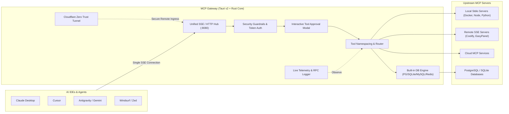

# MCP Gateway

<p align="center">
  
</p>

<p align="center">
  <strong>High-Performance Desktop Gateway & Multi-Transport Multiplexer สำหรับ Model Context Protocol (MCP)</strong>
</p>

<p align="center">
  <a href="README.md">English</a> | <a href="README_TH.md">ภาษาไทย</a>
</p>

<p align="center">
  
  
  
  
  
  
  
</p>

---

## 📖 ภาพรวมของโปรเจกต์ (Overview)

**MCP Gateway** คือแอปพลิเคชัน Desktop ระดับประสิทธิภาพสูง (Native Desktop Control Plane & Reverse Proxy) สำหรับ [Model Context Protocol (MCP)](https://modelcontextprotocol.io/) พัฒนาด้วย **Tauri v2 (Rust Core)** ผสานกับ **React 19, TypeScript และ Tailwind CSS v4**

โดยปกติ เมื่อใช้งาน AI IDEs และ Agents ต่างๆ เช่น Cursor, Claude Desktop, Antigravity, Windsurf หรือ Zed ผู้ใช้จำเป็นต้องตั้งค่าและรัน MCP Server แยกย่อยทีละตัว ทำให้เกิดปัญหา:
- ต้องจัดการพอร์ตซ้ำซ้อนและการตั้งค่ากระจัดกระจายในไฟล์คอนฟิกหลายแห่ง
- สิ้นเปลืองทรัพยากรเครื่อง (RAM/CPU) จากการรันโพรเซสซ้ำซ้อน
- ไม่มีระบบตรวจสอบความปลอดภัย (Access Control) หรือสิทธิ์การเรียกใช้ Tool ที่อันตราย
- ขาดความสามารถในการตรวจสอบบันทึกการรับส่งข้อมูล (Traffic & RPC Observability)

**MCP Gateway เข้ามาแก้ปัญหานี้อย่างครบวงจร**:
- ทำหน้าที่เป็น **ศูนย์กลางเชื่อมต่อเพียงจุดเดียว (Single Unified Endpoint)** ผ่าน SSE/HTTP (`http://127.0.0.1:8080/sse`) สำหรับ AI Clients ทั้งหมด
- รองรับการเชื่อมต่อไปยัง Downstream MCP Servers หลากหลายโปรโตคอลพร้อมกัน ทั้ง **Stdio**, **Server-Sent Events (SSE)** และ **Streamable HTTP**
- รวมศูนย์การค้นหา Tools, Prompts, Resources, เชื่อมต่อฐานข้อมูลในตัว และเสริมความปลอดภัยด้วยระบบ Guardrails & Approvals



---

## ✨ ความสามารถหลัก (Features & Capabilities)

### 1. ⚡ รวมศูนย์ Multi-Transport เชื่อมต่อ AI ด้วย URL เดียว
- **Single Endpoint สำหรับ AI**: ตั้งค่าใน Claude Desktop หรือ Cursor เพียง URL เดียว (`http://127.0.0.1:8080/sse`) เข้าถึงทุก Server ได้ทันที
- **รองรับ Transport หลากหลาย**:
  - **Stdio**: Local binaries, Node script (`npx`), Python script (`uvx`), Docker containers
  - **SSE (Server-Sent Events)**: การเชื่อมต่อแบบสตรีมมิ่งสด
  - **Streamable HTTP**: Remote MCP Server บนคลาวด์ พร้อม Custom Authentication Headers
- **Smart Tool Namespacing**: แยกชื่อ Tool อัตโนมัติ ป้องกันชื่อชนกันระหว่างเซิร์ฟเวอร์ (เช่น `coolify__<tool>`, `github__<tool>`)

### 2. 🛡️ ความปลอดภัยระดับองค์กร (Enterprise Security & Guardrails)
- **ระบบ Bearer Token**: ออกโทเคน, กำหนดวันหมดอายุ, ตั้งขอบเขตสิทธิ์ (Scopes) และเพิกถอนสิทธิ์ได้ทันที
- **นโยบายสิทธิ์แบบละเอียด (Granular Permission Policies)**: กำหนดพฤติกรรมแยกตาม Server หรือตาม Tool:
  - `Allow`: ให้อนุมัติรันอัตโนมัติ
  - `Require Approval`: ให้แสดงหน้าต่างถามการยืนยันจากผู้ใช้ก่อนรันเสมอ
  - `Deny`: สั่งบล็อกการเรียกใช้งาน
- **Interactive Approval Modal**: หน้าต่าง Popup ยืนยันการทำงานของ Tool ที่มีความเสี่ยงสูง (เช่น คำสั่งแก้ไขฐานข้อมูล, การลบ Container, การแก้ไฟล์สำคัญ)
- **นโยบาย Zero-Secrets**: ไม่เก็บและไม่แสดงรหัสผ่าน, API Token ใน Log หรือส่งกลับไปยัง Client ในกรณีเกิด Error

### 3. 🌐 Cloudflare Tunnel (รีโมตแชร์ผ่าน Zero-Trust ได้อย่างปลอดภัย)
- **แชร์ MCP Gateway ทางไกล**: เปิดให้เพื่อนร่วมทีมหรือ AI Agent จากภายนอกเชื่อมต่อเข้ามายัง MCP Gateway ในเครื่องได้ผ่าน HTTPS โดยไม่ต้อง Forward Port หรือมี Public IP
- **ควบคุมได้ในแอป**: ตรวจสอบสถานะการทำงาน, สั่ง Start/Stop Tunnel และตรวจสอบ Public Hostname ได้โดยตรง

### 4. 🗄️ Built-in Database Engine (PostgreSQL, SQLite, MySQL, Redis)
- **Native Rust Connectors**: ประสิทธิภาพสูงด้วย Driver ระดับ Native ใน Rust
- **Table & Schema Inspector**: สำรวจโครงสร้างตาราง, Data Types, Primary Keys และ Relationships
- **SQL Query Console**: ทดสอบรันคำสั่ง SQL (Parameterized queries), สั่ง Explain ดู Execution Plan และทดสอบงานด้านข้อมูลได้อย่างปลอดภัย

### 5. 🧪 Interactive Tools Explorer & Playground
- **JSON Schema Inspector**: ถอดรหัสโครงสร้างพารามิเตอร์ของ Tool (`inputSchema`) ออกมาเป็นฟอร์มกรอกข้อมูลอัตโนมัติ
- **Live Tool Tester**: กดทดสอบยิงคำสั่งเรียกใช้ Tool ได้ทันทีในแอป พร้อมดูผลลัพธ์ JSON และ Latency เวลาตอบสนองจริง
- **ระบบค้นหาและแบ่งหน้า**: มีระบบ Search, กรองประเภท, ปรับเรียงลำดับ (Sorting) และ Pagination รองรับ Tools จำนวนมากได้อย่างลื่นไหล

### 6. 📜 Resources & Prompts Explorer
- **MCP Resources**: สำรวจและเปิดดูพรีวิวไฟล์ข้อมูล, สกีมาฐานข้อมูล หรือ Resource URIs ที่แต่ละ Server เปิดให้บริการ
- **Prompt Templates**: ตรวจสอบ Prompt Template ที่ลงทะเบียนไว้ พร้อมดู Parameter Slots และตัวอย่างคำถาม

### 7. 📊 บันทึกการรับส่งข้อมูลแบบเรียลไทม์ (Live Traffic & RPC Telemetry)
- **Live JSON-RPC Stream**: ดูสตรีมข้อความขาเข้า-ขาออกสดๆ (`tools/call`, `tools/list`, `resources/read`, `ping`)
- **วัดค่าประสิทธิภาพ (Latency Telemetry)**: แสดงความเร็ว Roundtrip Response (ms), อัตราความสำเร็จ และสถิติการใช้งานประจำวัน
- **เครื่องมือจัดการ Log**: ค้นหาข้อความใน Log, เลือกล็อกการเลื่อนจออัตโนมัติ (Auto-scroll), หยุดชั่วคราว และ Export Log เป็นไฟล์ JSON ได้ใน 1 คลิก

### 8. 🔄 ตรวจจับการตั้งค่าของ IDE อัตโนมัติ (Auto-Discovery & Sync)
- **สแกนคอนฟิกเดิมในเครื่อง**: ดึงข้อมูล MCP Servers เดิมจาก:
  - Cursor (`~/.cursor/mcp.json`)
  - Antigravity / Gemini CLI (`~/.gemini/config/mcp_config.json`)
  - Claude Desktop (`claude_desktop_config.json`)
  - Windsurf
- **ส่งออกคอนฟิกใน 1 คลิก**: มีปุ่มสร้าง `mcp.json` สำเร็จรูปให้ Copy ไปวางใน IDE ที่ต้องการได้ทันที

### 9. 🎨 ประสบการณ์ Desktop ที่ทันสมัยและตอบสนองได้ทุกขนาดหน้าจอ
- **Responsive UI**: ออกแบบด้วยสไตล์ Minimal Dark Mode, แถบ Sidebar พับเก็บเป็นแถบไอคอน (Icon Rail) พร้อมแสดง Tooltip สวยงาม
- **Smart Buttons**: ซ่อนข้อความของปุ่มอัตโนมัติเมื่อเปิดหน้าต่างขนาดเล็กเพื่อป้องกัน UI ล้นขอบ
- **ระบบ Pagination & Multi-Column Sorting**: จัดเรียงตารางและแบ่งหน้าครบทุกแท็บ
- **Desktop App Icon แบบใส 100%**: โลโก้ Quantum Gateway เรืองแสงแบบไม่มีกรอบพื้นหลังสีดำ สำหรับ macOS Dock (`.icns`), Windows (`.ico`) และ Web Favicon

---

## 🚀 การติดตั้งและเริ่มต้นใช้งาน (Getting Started)

### ความต้องการของระบบ (Prerequisites)
- **Node.js** (v20 ขึ้นไป) หรือ **Bun** (แนะนำ)
- **Rust** (เวอร์ชัน Stable ล่าสุด) และ **Cargo** (สำหรับคอมไพล์ Tauri v2 Core)

### ขั้นตอนการรัน

1. **โคลนคลังโค้ด (Clone Repository)**:
   ```bash
   git clone https://github.com/neondeveloperz/mcp-gateway.git
   cd mcp-gateway
   ```

2. **ติดตั้ง Dependencies**:
   ```bash
   bun install
   # หรือใช้: npm install
   ```

3. **รันแอปพลิเคชันในโหมด Development**:
   ```bash
   bun run tauri dev
   ```

4. **คอมไพล์เป็นตัวติดตั้งสำหรับ Production**:
   ```bash
   bun run tauri build
   ```
   ไฟล์ตัวติดตั้งสำหรับติดตั้งลงเครื่อง (`.dmg` สำหรับ macOS, `.msi` / `.exe` สำหรับ Windows) จะอยู่ที่โฟลเดอร์ `src-tauri/target/release/bundle/`

---

## 🔌 การเชื่อมต่อเข้ากับ AI Clients ต่างๆ

นำ URL ของ MCP Gateway ไปใส่ในไฟล์คอนฟิกของ AI Client ของคุณเพียงชุดเดียว:

### 1. Claude Desktop
แก้ไขไฟล์ `~/Library/Application Support/Claude/claude_desktop_config.json` (macOS) หรือ `%APPDATA%\Claude\claude_desktop_config.json` (Windows):

```json
{
  "mcpServers": {
    "mcp-gateway": {
      "command": "curl",
      "args": ["-s", "-N", "http://127.0.0.1:8080/sse"],
      "headers": {
        "Authorization": "Bearer YOUR_GATEWAY_TOKEN"
      }
    }
  }
}
```

### 2. Cursor (`~/.cursor/mcp.json`)
```json
{
  "mcpServers": {
    "mcp-gateway": {
      "url": "http://127.0.0.1:8080/sse",
      "headers": {
        "Authorization": "Bearer YOUR_GATEWAY_TOKEN"
      }
    }
  }
}
```

### 3. Antigravity / Gemini CLI (`~/.gemini/config/mcp_config.json`)
```json
{
  "mcpServers": {
    "mcp-gateway": {
      "url": "http://127.0.0.1:8080/sse",
      "headers": {
        "Authorization": "Bearer YOUR_GATEWAY_TOKEN"
      }
    }
  }
}
```

---

## 🛠️ โครงสร้างโปรเจกต์ (Project Structure)

```
mcp-gateway/
├── public/                 # Static assets, favicon, app-icon
├── src-tauri/              # Rust Native Backend (Tauri v2 Core)
│   ├── src/
│   │   ├── lib.rs          # จุดลงทะเบียน Tauri Commands และ Lifecycle
│   │   ├── gateway.rs      # กลไก Reverse Proxy, SSE Engine & Multiplexer
│   │   ├── discovery.rs    # ตรวจสอบระบบ Host, Telemetry และสแกนคอนฟิก IDE
│   │   ├── database.rs     # ระบบเชื่อมต่อ PostgreSQL, SQLite, MySQL, Redis
│   │   ├── security.rs     # ระบบตรวจสอบ Bearer Token และ Permission Guardrails
│   │   ├── tunnel.rs       # กลไกจัดการ Cloudflare Tunnel
│   │   └── types.rs        # Data Types และ Structs ร่วมในระบบ
│   ├── icons/              # ไอคอนแอปพลิเคชัน (.icns, .ico, png)
│   └── Cargo.toml          # กำหนด Dependencies และ Optimization ของ Rust
├── src/                    # Frontend GUI (React 19 + TypeScript + Tailwind v4)
│   ├── components/
│   │   ├── overview/       # แดชบอร์ดสรุปผลภาพรวม และกราฟสถิติ
│   │   ├── servers/        # จัดการเซิร์ฟเวอร์ MCP และสถานะการเชื่อมต่อ
│   │   ├── database/       # เครื่องมือสำรวจฐานข้อมูลและรัน SQL
│   │   ├── tools/          # เครื่องมือทดสอบยิง Tool (Playground)
│   │   ├── resources/      # เครื่องมือสำรวจ Resources และ Prompt Templates
│   │   ├── logs/           # หน้าระบบตรวจดู Traffic Log สด
│   │   ├── tunnel/         # ควบคุม Cloudflare Tunnel
│   │   ├── tokens/         # สร้างและจัดการ API Bearer Tokens
│   │   ├── security/       # กำหนดนโยบายความปลอดภัยและ Approval Modal
│   │   ├── status/         # ตรวจสอบสุขภาพระบบ (System Health & Uptime)
│   │   └── ui/             # shadcn/ui components, pagination, sorting
│   ├── lib/
│   │   └── mcp-service.ts  # Service สื่อสารกับ Tauri Core และ Event Hub
│   ├── App.tsx             # หน้าจอหลักและการสลับแท็บ
│   └── main.tsx            # จุดเริ่มต้นของ React App
├── package.json
├── README.md               # เอกสารภาษาอังกฤษ (EN)
└── README_TH.md            # เอกสารภาษาไทย (TH)
```

---

## 🛡️ นโยบายความเป็นส่วนตัวและความปลอดภัย (Security & Privacy)

- **Local-First 100%**: โค้ดและข้อมูลทั้งหมดประมวลผลอยู่บนเครื่องของผู้ใช้ (`127.0.0.1`) เท่านั้น ไม่มีการส่งข้อมูลสถิติหรือโค้ดออกไปยังเซิร์ฟเวอร์ภายนอก เว้นแต่จะเปิดใช้งาน Cloudflare Tunnel ด้วยตนเอง
- **Human-in-the-Loop**: รองรับการตั้งค่าให้อนุญาตเฉพาะคำสั่งปลอดภัย และแจ้งเตือนให้ผู้ใช้กดยืนยันก่อนเสมอเมื่อมีการเรียกคำสั่งที่อาจเปลี่ยนแปลงข้อมูล
- **Sandboxing**: ปฏิบัติตามหลักความปลอดภัย ไม่เก็บหรือเปิดเผยข้อมูล Sensitive ในบันทึก Log

---

## 📄 สัญญาอนุญาต (License)

โปรเจกต์นี้เผยแพร่ภายใต้สัญญาอนุญาต [MIT License](LICENSE)
